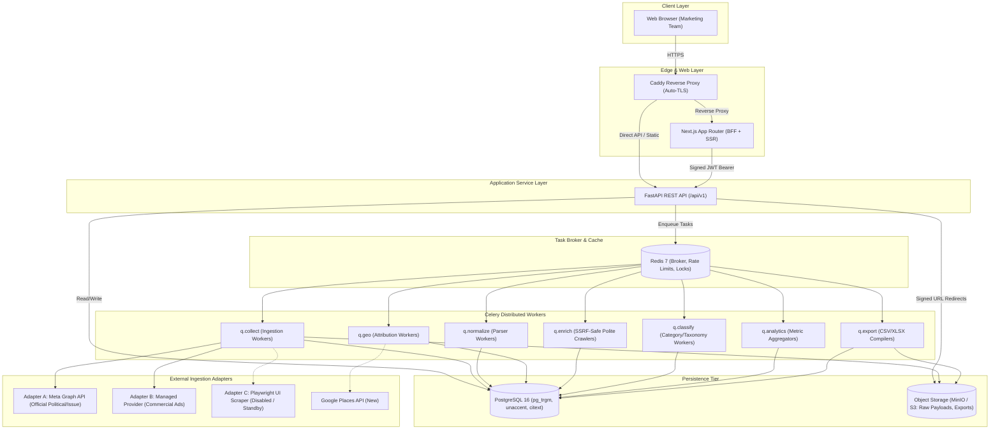
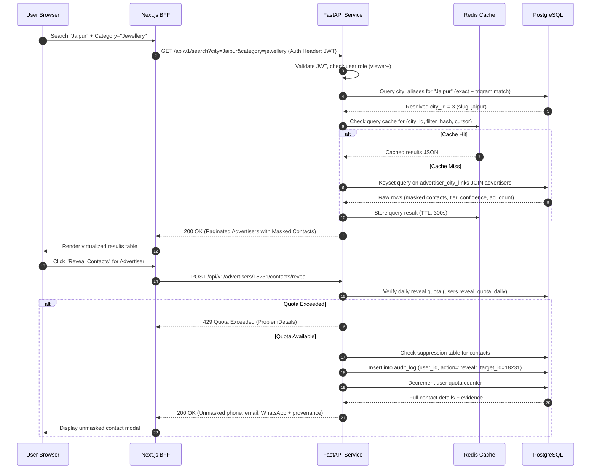

# System Architecture — AdAtlas India

## 1. Purpose
Define the system topology, component interactions, data ingestion pipelines, execution queues, storage tiers, and failure recovery mechanisms for the AdAtlas platform.

## 2. Scope
Covers the end-to-end architecture encompassing the Next.js frontend with BFF, FastAPI REST services, Celery worker task queues, PostgreSQL 16 database, Redis 7 cache/broker, MinIO/S3 object storage, and external adapter boundaries.

## 3. Decisions (Link ADRs)
- **ADR-0001:** Multi-Adapter Collection Architecture (Adapter A, B, C).
- **ADR-0004:** Single-VM Containerized Topology in India Region.
- **ADR-0005:** Auth.js Session Management with BFF Signed JWT for FastAPI.
- **ADR-0012:** Modular Monolith with Asynchronous Task Queues over Microservices.
- **ADR-0013:** PostgreSQL Trigram & Full-Text Search First over External Search Clusters.

## 4. Detailed Design

### 4.1 Architectural Principles
1. **Modular Monolith + Asynchronous Workers:** Single unified codebase with clean domain separation (`collectors`, `pipeline`, `services`, `api`). Avoid distributed transaction overhead while isolating long-running extraction workloads in Celery.
2. **Pluggable Edge Adapters:** Every external data ingestion point conforms to a standard Python `Protocol` (`AdSourceAdapter`) with explicit capability declarations and cost estimations.
3. **Raw Payloads as Permanent Source of Truth:** Unmodified source payloads are compressed (zstd) and saved to object storage (`raw_payloads`). Normalized relational tables represent disposable projections re-derivable via `reprocess --from-raw`.
4. **Idempotence and Checkpointing:** Every pipeline stage is idempotent, relying on database-level constraints (`ON CONFLICT DO UPDATE`) and cursor checkpoints.
5. **Inference Provenance:** Algorithmic inferences (geo attribution, contact extraction, categorization) persist source evidence, confidence scores, and model version identifiers.
6. **Fail-Closed Privacy & Compliance:** The suppression registry is evaluated synchronously on both write and read paths.
7. **Strict Budget Boundaries:** Billable external API calls (provider queries, Google Places, LLMs) decrement central budget ledgers and halt automatically upon reaching quota.

### 4.2 System Component Topology

### 4.3 Search Request Flow

### 4.4 Job Lifecycle State Machine

```mermaid
stateDiagram-v2
    [*] --> pending: Celery Beat schedules job
    pending --> running: Worker claims task (Redis lock acquired)
    running --> succeeded: Cursor reaches end / batch complete
    running --> partial: Ingested items committed; rate limit paused run
    running --> failed: Unexpected exception / network abort
    running --> blocked: Upstream challenge or 429 detected
    failed --> pending: Retried with exponential backoff
    blocked --> pending: Cool-down elapsed (>= 6 hours)
    pending --> cancelled: Operator cancels job via Admin API
    running --> cancelled: Kill switch triggered (SIGTERM handled)
    succeeded --> [*]
    cancelled --> [*]
```

### 4.5 Task Queue Routing & Capacity Planning
| Queue Name | Routing Key | Concurrency | Target Rate Limit | Task Purpose |
|---|---|---|---|---|
| `q.collect` | `collect.#` | 2–4 workers | Dynamic based on provider quota | Ingest raw ad batches from Adapter A/B |
| `q.normalize` | `normalize.#` | 4–8 workers | CPU bound (high) | Parse payloads, compute content hashes, canonicalize URLs |
| `q.geo` | `geo.#` | 4 workers | 100 req/min (Places API capped) | Calculate multi-signal city attribution scores |
| `q.enrich` | `enrich.#` | 8–16 workers | 1 req / 2s / domain (token bucket) | Crawl target websites via SSRF-safe polite fetcher |
| `q.classify` | `classify.#` | 4 workers | Batched / local rules | Map ad copy to category taxonomy |
| `q.analytics` | `analytics.#` | 2 workers | Scheduled nightly | Aggregate daily metrics and compute city scores |
| `q.export` | `export.#` | 2 workers | On demand | Stream CSV/XLSX exports to S3 |

### 4.6 Failure Modes & Self-Healing
- **Worker Crash Mid-Task:** Celery tasks run with `acks_late=True`. Redis leases expire, and the reaper process re-enqueues unacknowledged jobs from the last stored cursor checkpoint (PIPE-02).
- **Poison Payloads:** If an item fails processing across 3 consecutive retry attempts, it is routed to the `dead_letters` table along with full stack traces and input arguments (PIPE-03).
- **Transient Network Partitions:** All database and Redis connection pools implement automatic reconnection with exponential backoff and connection health checks.

## 5. Edge-Case IDs Referenced
- `PIPE-01` (Idempotent upsert handling)
- `PIPE-02` (Worker crash mid-run recovery)
- `PIPE-03` (Poison message isolation in dead_letters)
- `PIPE-08` (Budget runaway protection)
- `PIPE-11` (Scheduler overlap locking)
- `SEC-01` (SSRF guard on all worker crawling)

## 6. Open Questions
- Final decision on production message broker persistence (Redis AOF vs AWS SQS/ElastiCache) prior to Phase 12 deployment.

## 7. Acceptance Checklist
- [x] Full component architecture diagram provided in Mermaid format.
- [x] Search request flow and contact reveal sequence diagram documented.
- [x] Ingestion lifecycle state diagram mapped.
- [x] Task queues, rate limits, and capacity plan defined.
- [x] Failure recovery mechanisms and dead-letter routing specified.

## 8. Last Updated
- Date: 2026-11-04
- Version: 1.0 (Phase 0 Baseline)

