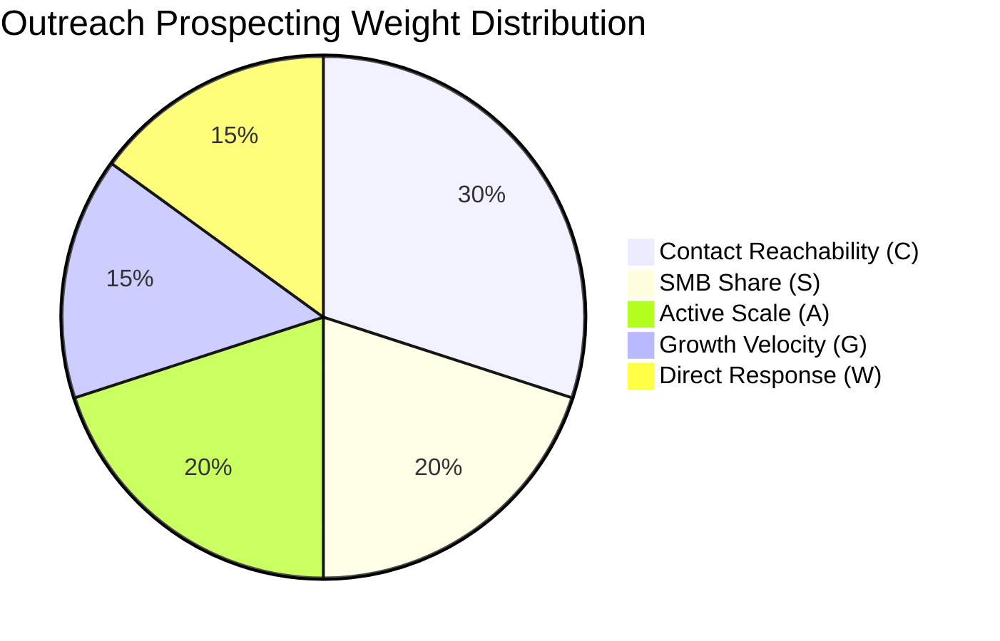

# City Scoring & Market Vitality Analytics — AdAtlas India

## 1. Purpose
Define the algorithmic framework, proxy metrics, goal-driven weight profiles, and data sufficiency guards used to objectively evaluate and compare the five target Indian cities.

## 2. Scope
Applies to the analytics pipeline (`q.analytics`), daily rollup jobs (`city_metrics_daily`), and the comparison API (`GET /api/v1/compare`).

## 3. Decisions (Link ADRs)
- **ADR-0007:** Goal-Driven Multi-Profile City Scoring Framework.
- **ADR-0009 & ADR-0010:** Spatial Scope Boundaries for Metro Densities.

## 4. Detailed Design

### 4.1 The Proxy Metric Rationale (R2)
Meta does not publish ad spend, impression figures, or monetary budgets for commercial campaigns outside the EU. Any software claiming to report commercial Meta ad spend in India relies on unverified, fabricated guesses. AdAtlas strictly rejects commercial spend modeling. Instead, city vitality is evaluated using observable, empirical proxy metrics capturing advertising activity, creative investment, and reachability.

### 4.2 Core Metric Catalog
Metrics are calculated over trailing 30-day and 90-day observation windows, filtered by default to local and regional advertisers (`scope IN ('local', 'regional')`).

| Metric Code | Metric Name | Formal Definition | Mathematical Formulation | Strategic Significance |
|---|---|---|---|---|
| **A** | Active Advertisers | Total distinct advertisers with $\ge 1$ active ad during the window, weighted by city link confidence. | $\sum_{a \in Ads} \text{conf}(a, city)$ | Absolute market scale. |
| **D** | Advertiser Density | Active advertisers scaled per 100,000 urban residents. | $\frac{A}{\text{urban\_population}} \times 100,000$ | Normalized penetration; prevents mega-cities (Mumbai/Delhi) from dominating smaller markets. |
| **G** | Advertiser Growth Velocity | Ratio of new advertisers first seen in the last 30 days to total active advertisers. | $\frac{A_{\text{first\_seen} \le 30d}}{A}$ | Market momentum and new business adoption rate. |
| **L** | Ad Longevity | Median active delivery days for ads launched $\ge 30$ days ago (Kaplan-Meier right-censoring handling). | $\text{Median}(\text{delivery\_days} \mid \text{start} \le \text{now} - 30d)$ | Sustained commercial viability; businesses only keep profitable ads running. |
| **R** | Creative Refresh Cadence | Mean count of distinct creative variants (`content_hash`) per advertiser per month. | $\frac{\text{distinct\_creatives}}{A}$ | Operational sophistication and active A/B testing intensity. |
| **C** | Contact Reachability | Share of confirmed advertisers possessing $\ge 1$ verified, non-suppressed, non-flagged business contact. | $\frac{A_{\text{has\_verified\_contact}}}{A}$ | Practical prospecting efficiency for sales teams. |
| **S** | SMB Share | Percentage of active advertisers operating $\le 10$ active ad creatives simultaneously. | $\frac{A_{\text{active\_ads} \le 10}}{A}$ | Long-tail small business opportunity vs. enterprise domination. |
| **W** | Direct-Response Share | Share of ads featuring direct-action conversational CTAs (WhatsApp, Call, Send Message). | $\frac{\text{Ads}_{\text{CTA} \in \{\text{'WHATSAPP'}, \text{'CALL'}, \text{'MESSAGE'}\}}}{\text{Total Ads}}$ | Commercial direct-to-consumer conversational sales culture. |
| **H** | Category Diversity | Complement of the Herfindahl-Hirschman Index across L1 categories. | $1 - \sum_{i=1}^N s_i^2$ ($s_i = \text{share of cat } i$) | Market resilience; high diversity indicates balanced local industry. |
| **K** | Competitive Intensity | Mean active ads per advertiser within a given category. | $\frac{\text{Category Active Ads}}{A_{\text{category}}}$ | Saturation level within specific product verticals. |

### 4.3 Goal-Driven Scoring Profiles
Because "better" depends on the user's specific commercial objective, AdAtlas provides three pre-configured weighting profiles (customizable via UI sliders):

1. **Outreach Prospecting Profile (Default):**
   - *Goal:* Maximize the volume of reachable, responsive local businesses for sales outreach.
   - *Formula Weights:* $C: 0.30 \cdot S: 0.20 \cdot A: 0.20 \cdot G: 0.15 \cdot W: 0.15$
2. **Market Maturity Profile:**
   - *Goal:* Identify established, sophisticated digital advertising ecosystems.
   - *Formula Weights:* $A: 0.25 \cdot D: 0.20 \cdot L: 0.20 \cdot H: 0.20 \cdot R: 0.15$
3. **Low-Competition Market Entry Profile:**
   - *Goal:* Discover rapidly emerging, under-served markets with minimal competitor crowding.
   - *Formula Weights:* $(1 - D): 0.30 \cdot (1 - K): 0.25 \cdot G: 0.25 \cdot C: 0.20$

### 4.4 Normalization & Scoring Algorithm
With a small evaluation cohort of five cities, standard min-max scaling or percentile ranking produces volatile, erratic swings. AdAtlas utilizes cross-city median ratio scaling:

1. **Median Ratio:** For each metric $m$ across the five cities, determine the median value $\tilde{m}$.
2. **Log2 Transform & Clamping:** Compute normalized score $z_m = \log_2\left(\frac{m}{\tilde{m}}\right)$, clamped to the interval $[-1.0, +1.0]$.
3. **Linear Mapping to 0–100 Scale:**
   $$S_m = 50 + (z_m \times 50)$$
   (A city exactly at the median scores 50; a city with double the median scores 100; a city with half the median scores 0).
4. **Composite City Score:**
   $$\text{Final Score} = \sum_{m} w_m S_m$$
5. **Anti-Spam Winsorization:** To prevent bot farms or catalogue advertisers from distorting counts, an individual advertiser's contribution to active ads is capped at the 95th percentile ($p95$) of the advertiser ad-distribution curve (ANA-03).

### 4.5 Data Sufficiency Guard & Explainability
- **Sufficiency Threshold (`sample_ok`):** If a city has fewer than `MIN_SAMPLE` (default 200) confirmed advertisers, or if a metric has fewer than 30 observations:
  - The aggregate score is greyed out in the UI.
  - A prominent banner displays: *"Insufficient sample size for statistically reliable scoring."* (ANA-01, SRCH-11).
- **Explainability Breakdown:** Every comparison result returns the top positive contributing metrics and top negative contributing metrics alongside raw metric values.
- **Snapshot Date Alignment:** Comparisons enforce uniform snapshot alignment: all compared cities must reflect metrics computed on the identical calendar day (`day`).
- **Mandatory Disclosure Notice:** All scorecards and comparison exports must include the text:
  > *"Based on Meta Ad Library activity. Commercial ad spend and impressions are not published by Meta outside the EU and are not estimated."*

## 5. Edge-Case IDs Referenced
- `ANA-01` (Small-sample cities e.g. Jaipur vs Mumbai)
- `ANA-02` (Ad collation duplicates vs distinct creatives)
- `ANA-03` (Spam flood winsorization at p95)
- `ANA-04` (Seasonal advertising fluctuations e.g. Diwali)
- `ANA-05` (Mumbai-HQ misattribution bias)
- `ANA-06` (Right-censored ad longevity handling)
- `ANA-07` (Strict avoidance of commercial spend claims)
- `ANA-08` (Score stability via median-ratio scaling)
- `ANA-09` (Snapshot alignment requirement)
- `ANA-10` (Category taxonomy versioning)

## 6. Open Questions
- Calibrating `MIN_SAMPLE` specifically for Jaipur and Kolkata during Phase 2 baseline data ingestion.

## 7. Acceptance Checklist
- [x] Rationale for proxy metrics over unverified spend documented.
- [x] Complete catalog of 10 proxy metrics formally defined.
- [x] Three goal-driven weight profiles specified.
- [x] Median-ratio mathematical normalization algorithm detailed.
- [x] Data sufficiency guard and explainability mechanisms committed.
- [x] All 10 ANA edge-case IDs cross-referenced.

## 8. Last Updated
- Date: 2026-11-04
- Version: 1.0 (Phase 0 Baseline)

