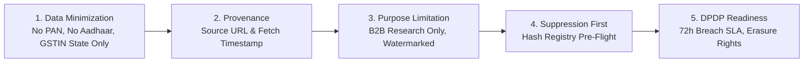

# Legal, Regulatory & Compliance Specification — AdAtlas India

## 1. Purpose
Document the data protection classification, statutory compliance architecture, suppression handling, and regulatory risk controls under Indian law (Digital Personal Data Protection Act 2023 and DPDP Rules 2025, TRAI Telecom Commercial Communications Customer Preference Regulations, and copyright frameworks).

> **Important Notice:** This document constitutes engineering system design and operational controls. It does not replace formal legal advice. Production launch is gated upon formal written sign-off from qualified legal counsel (ADR-0002).

## 2. Scope
Applies to all data collection, contact enrichment, storage, search delivery, API access, CSV/XLSX export generation, and public opt-out processing across AdAtlas.

## 3. Decisions (Link ADRs)
- **ADR-0001:** Multi-Adapter Architecture and Adapter C Legal Gating.
- **ADR-0002:** Compliance Boundary & Legal Sign-off for Business Contact Enrichment.
- **ADR-0011:** Data Retention Schedules.

## 4. Detailed Design

### 4.1 Data Classification Taxonomy

| Classification Level | Examples & Artifacts | Storage & Access Controls | Exposure & Export Governance |
|---|---|---|---|
| **Public Ad Metadata** | Ad copy text, headlines, CTA labels, Meta page names, delivery dates, canonical Meta permalinks. | PostgreSQL plaintext; normalized tables. | Accessible to all authenticated users (`viewer+`); included in standard search responses. |
| **B2B Business Contact** | Corporate telephone landlines, department role emails (`info@`, `sales@`), official website domains, corporate LinkedIn pages. | PostgreSQL encrypted at rest; masked by default in API (`+91 98•••• ••21`). | Unmasked only upon explicit reveal by `marketing+` users; audited in `audit_log`; subject to daily quotas. |
| **Personal-Data-Risk Contact** | Webmail addresses (`@gmail.com`, `@yahoo.com`), named corporate grievance officers, sole proprietor mobile phone numbers. | Encrypted at rest; tagged with `flags = {'personal_data_risk'}`. | Higher scrutiny; excluded from standard marketing bulk exports unless explicit compliance permission is granted. |
| **System Secrets** | Meta Graph API tokens, provider API keys, database credentials, JWT HMAC signing secrets. | Loaded strictly via environment variables; never written to database or logs. | Zero user exposure; redacted by automated CI filters (`gitleaks`). |
| **Prohibited Data** | National identity numbers (PAN, Aadhaar), full GSTIN strings, personal Facebook friend lists, private phone books. | **Strictly forbidden.** Dropped in memory pre-write. | Never ingested, processed, or persisted under any circumstance. |

### 4.2 Core Compliance Principles

1. **Strict Data Minimization (LEG-03):**
   - The platform collects only information published directly by businesses for commercial contact purposes.
   - For GSTIN, regex parsers extract and persist ONLY the initial 2-digit state identifier (e.g. "08" for Rajasthan). The subsequent 10 alphanumeric characters represent the taxpayer's Permanent Account Number (PAN) and are discarded immediately in memory.
   - Government and public administration pages, educational primary schools, and political campaign entities are excluded from contact enrichment.
2. **Provenance & Attribution Verifiability:**
   - Every contact item in the `contacts` table must maintain an unbroken chain of evidence linking to `contact_evidence`, recording the originating landing URL, page kind (e.g. `/contact`, footer), extraction mechanism, and capture timestamp.
3. **Purpose Limitation & Terms of Use (LEG-04):**
   - Data gathered is licensed exclusively for internal B2B market research, competitive intelligence, and business-to-business prospecting.
   - Exported CSV/XLSX spreadsheets embed cryptographic watermarks identifying the exporting user, timestamp, and standard fair-use disclaimers.
4. **Suppression & Opt-Out Workflow (LEG-01, LEG-02):**
   - The platform provides a public, unauthenticated endpoint (`POST /api/v1/optout`) backed by email/SMS token verification.
   - Upon verification of ownership, target values are normalized, hashed via SHA-256, and inserted into `suppression`.
   - All matching rows in `contacts` are immediately purged.
   - The suppression check is executed pre-flight on collection workers, API queries, and export tasks. Suppressed entities can never be re-introduced by automated re-crawling.
5. **Telecom & Direct Marketing Regulations (TRAI & WhatsApp):**
   - *Telecom Commercial Communications Regulations:* India's National Do-Not-Disturb (NDNC) registry regulates telemarketing. AdAtlas exports include a mandatory `dnd_status` column set to `unknown` with prominent UI notices that users must verify numbers against the NDNC registry prior to unsolicited calling (LEG-05).
   - *WhatsApp Business Messaging Policy:* UI documentation reminds users that WhatsApp outreach requires opt-in consent; AdAtlas does not provide automated bulk messaging tools (LEG-06).
6. **DPDP Act & Rules 2025/2027 Alignment:**
   - *Data Principal Rights:* Mechanisms to exercise right of access, right of correction, and right of erasure (LEG-02).
   - *Breach Notification SLA:* Runbook procedures engineered to support notice to the Data Protection Board of India (DPBI) and affected entities within the statutory 72-hour notification window (LEG-10).
7. **Source Isolation & Cease-and-Desist Readiness (LEG-09):**
   - Every ad and contact maintains a `source` tag identifying its ingestion adapter.
   - If an upstream platform issues a legal takedown notice, operators can trigger `make purge-source SOURCE=<adapter>` to expunge all records derived from that provider within minutes.
8. **Ad Creative Copyright (LEG-08):**
   - The platform stores ad body copy, metadata, an internal low-resolution thumbnail, and a canonical link to Meta's Ad Library. Raw creative assets (high-res videos, imagery) are never mirrored or redistributed.

### 4.3 Open Questions for Human Legal Counsel
Prior to production go-live (Phase 12), human legal counsel must review and provide formal written responses to the following questions:
1. Does the extraction of business contact details from publicly available landing pages of Meta advertisers fall squarely under legitimate B2B processing grounds under the DPDP Act 2023?
2. Are sole proprietorships whose publicly listed business contact is a personal mobile number or personal email subject to additional consent requirements under DPDP Rules 2025?
3. What specific language must be incorporated into the AdAtlas Terms of Service to hold export users strictly liable for compliance with TRAI telemarketing regulations?
4. What is the final statutory form and timeline for personal data breach reporting under DPDP Rules 2025?

## 5. Edge-Case IDs Referenced
- `LEG-01` (Opt-out and suppression list cycle)
- `LEG-02` (Full erasure and right to be forgotten)
- `LEG-03` (Data minimization; PAN and Aadhaar exclusion)
- `LEG-04` (Purpose limitation and export watermarking)
- `LEG-05` (TRAI DND compliance notice)
- `LEG-06` (WhatsApp Business messaging policy)
- `LEG-07` (Quarantine of sensitive categories)
- `LEG-08` (Ad creative copyright protection)
- `LEG-09` (Kill switch and selective source purge)
- `LEG-10` (Data breach incident response)

## 6. Open Questions
- Awaiting formal counsel sign-off on the 4 questions listed in Section 4.3.

## 7. Acceptance Checklist
- [x] Data classification matrix documented with handling standards.
- [x] Data minimization rules for PAN, Aadhaar, and GSTIN state codes defined.
- [x] Suppression and opt-out workflows specified.
- [x] TRAI DND and WhatsApp Business policy considerations documented.
- [x] Four formal open legal questions for counsel articulated.
- [x] All 10 LEG edge-case IDs cross-referenced.

## 8. Last Updated
- Date: 2026-11-04
- Version: 1.0 (Phase 0 Baseline)

