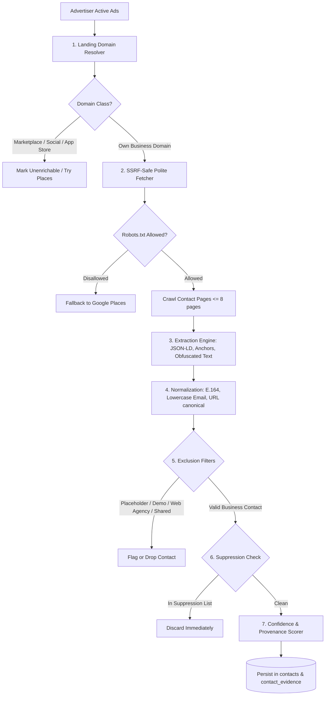

# Contact Enrichment Engine Specification — AdAtlas India

## 1. Purpose
Define the architecture, polite web crawling standards, extraction algorithms, validation filters, exclusion rules, and compliance boundaries for discovering verified public business contacts from advertiser web properties.

## 2. Scope
Applies to the contact extraction pipeline (`q.enrich`), processing destination landing pages and public corporate web properties for attributed advertisers.

## 3. Decisions (Link ADRs)
- **ADR-0002:** Ethical Contact Boundaries (No Personal Facebook Scraping, B2B Focus).
- **ADR-0008:** Google Places API Integration for Missing Contact Fallback.
- **ADR-0011:** 12-Month Retention Schedule for Unverified Contacts.

## 4. Detailed Design

### 4.1 Ingestion & Enrichment Pipeline Flow

### 4.2 Website Resolution & Domain Classification
1. **Primary Landing Domain:** Identify the modal registered domain (eTLD+1 via `tldextract`) across the advertiser's active ads.
2. **Landing Classification:**
   - **Own Web Property:** Crawlable standalone domain (e.g., `brandname.in`).
   - **Marketplace:** Amazon, Flipkart, Myntra, Meesho, IndiaMART, JustDial. **Scraping is strictly prohibited.**
   - **Social Walled Gardens:** Instagram profile, Facebook group, YouTube channel. Do not crawl.
   - **Direct WhatsApp CTA:** `wa.me/91...` or `api.whatsapp.com`. Parse target phone number directly as a verified WhatsApp contact.
   - **Lead Generation Forms:** Facebook native lead forms. Flag as `no_website_lead_gen`.
   - **Link-in-Bio Services:** Linktree, Bio.fm. Crawl only to extract destination corporate domain anchors.

### 4.3 Polite Web Crawler Standards
- **Mandatory SSRF Guard (SEC-01):** Every outbound request routes through `core.ssrf_guard`. DNS resolution occurs pre-connect, dropping RFC 1918, loopback, and metadata IPs (`169.254.169.254`). Validated at every redirect hop (maximum 5 hops).
- **Robots.txt & Crawl-Delay:** Fetch and honor `/robots.txt`. Respect explicit `Crawl-delay` headers. If contact paths are disallowed, abort crawling and log `robots_blocked` (CON-14).
- **Targeted Page Discovery:** Crawl homepage plus up to 6 discovered subpages matching contact-related URL slugs:
  `/(contact|about|reach-us|locations|stores|branches|privacy|terms|grievance)/i`.
- **Resource Limits:**
  - Connection timeout: 10 seconds.
  - Read timeout: 15 seconds.
  - Maximum decompressed body size: 2 MB (prevents compression bombs, CON-13).
  - Maximum crawl depth: Depth 1 (no recursive link crawling).
  - Maximum pages per domain per execution: 8 pages.
  - Per-domain rate limit: 1 request every 2 seconds enforced via Redis token bucket.
- **User-Agent Header:** Identifying corporate user agent:
  `User-Agent: AdAtlasBot/1.0 (+https://adatlas.in/bot; compliance@adatlas.in)`.

### 4.4 Extraction & Normalization Logic
1. **Structured Data First:** Parse Schema.org JSON-LD and microdata (`Organization`, `LocalBusiness`, `ContactPoint`, `PostalAddress`) using `extruct`. High trust factor.
2. **Hyperlink Anchors:** Extract `href="tel:..."`, `href="mailto:..."`, and WhatsApp click-to-chat links (`wa.me/...`).
3. **Indic Digit Normalization:** Map vernacular Indic numerals (Devanagari ०-९, Bengali ০-৯, Kannada ೦-೯) to ASCII 0-9 using `unicodedata.digit` prior to regex parsing (CON-04).
4. **De-Obfuscation:**
   - Decode Cloudflare email protection (`data-cfemail` XOR algorithm).
   - Resolve textual obfuscations: `name [at] domain [dot] com`, `name(at)domain(dot)com`.
5. **Phone Validation (`phonenumbers`):**
   - Parse with default region `IN`.
   - Normalize strictly to E.164 (e.g., `+919829012345`).
   - Categorize telecom subtype: `mobile`, `landline`, `tollfree`.
   - Drop telemarketing 140-series prefixes and numbers failing E.164 checksums (CON-03).
6. **Email Validation:**
   - Syntax validation via `email-validator`.
   - Domain MX record verification via `dnspython`. **Zero SMTP interactive probing.**
   - Tag freemail providers (`@gmail.com`, `@yahoo.com`, `@rediffmail.com`) as `personal_data_risk` (CON-07).

### 4.5 Exclusion Rules & Anti-Pollution Filters
- **Web Design Agencies:** Exclude contact numbers and emails appearing in close physical proximity (< 200 characters) to phrases like "Designed by", "Developed by", "Powered by", or "Theme by" (CON-05).
- **Shared Gateway Numbers:** Flag contacts associated with payment gateways (e.g. Razorpay support lines) or recurring theme templates. If a contact value appears across > 5 distinct registered domains, assign `flags = {'shared_third_party'}` and exclude from city coverage metrics (CON-18).
- **Placeholder Denylists:** Filter out known dummy contacts: `example@domain.com`, `info@yourdomain.com`, `test@test.com`, `9999999999`, `1234567890`, repeated-digit strings (CON-06).
- **Domain Mismatch:** Compute rapidfuzz string similarity between advertiser page name and website domain. If similarity < 0.60, mark `domain_mismatch` and drop (CON-10).

### 4.6 Confidence Scoring & Provenance Ledger
Every contact row records a confidence score ($0.0 \le c \le 1.0$) based on corroboration:

| Extraction Attribute | Base Confidence | Adjustments |
|---|---|---|
| Schema.org JSON-LD `ContactPoint` | 0.95 | +0.05 if domain matches website eTLD+1 |
| Explicit `tel:` or `mailto:` on `/contact` page | 0.90 | +0.05 if corroborated across >= 2 pages |
| WhatsApp Direct CTA in Ad Copy | 0.90 | Validated via E.164 parse |
| Header/Footer Anchor on Homepage | 0.80 | -0.10 if marked freemail |
| Unstructured Body Text Regex | 0.65 | -0.15 if no context words ("call", "email") nearby |
| Google Places API Match | 0.85 | Corroborated with physical address |

**Provenance Integrity:** Every contact record links to `contact_evidence`, recording `source_url`, `source_type`, `page_kind`, `fetched_at`, and raw payload pointer.

### 4.7 Re-Verification & Freshness Schedule
- Contacts undergo automated re-verification every **90 days**.
- If a contact is no longer detected during re-crawling, its flag updates to `stale`.
- Unverified contacts that remain unconfirmed after **12 months** are purged (ADR-0011).

## 5. Edge-Case IDs Referenced
- `CON-01` (No website at all; fallback to Places / WhatsApp CTA)
- `CON-02` (De-obfuscation of emails)
- `CON-03` (Indian phone format parsing)
- `CON-04` (Indic digit normalisation)
- `CON-05` (Web agency and developer attribution filter)
- `CON-06` (Placeholder dummy contact exclusion)
- `CON-07` (Freemail personal data risk classification)
- `CON-08` (Named corporate officers and privacy sensitivity)
- `CON-09` (JavaScript rendering fallback with Playwright)
- `CON-10` (Parked domains and domain mismatch filter)
- `CON-11` (Redirect chains and link-in-bio handling)
- `CON-12` (SSRF redirect blocks)
- `CON-13` (Crawler traps and compression bombs)
- `CON-14` (Robots.txt compliance)
- `CON-15` (WhatsApp deep-link parsing)
- `CON-16` (No SMTP probing)
- `CON-17` (90-day re-verification cycle)
- `CON-18` (Shared third-party call center numbers)
- `CON-19` (Branch-specific contact attribution)
- `CON-20` (GSTIN 2-digit state code extraction; PAN dropped)
- `SEC-01` (SSRF guard transport)
- `LEG-03` (Data minimization rules)

## 6. Open Questions
- Establishing budget allocations for Playwright rendering fallback on sites requiring client-side hydration for contact rendering.

## 7. Acceptance Checklist
- [x] SSRF-safe crawling constraints and domain limits defined.
- [x] Polite crawler parameters (timeouts, body caps, rate limits) specified.
- [x] Extraction algorithms for structured, anchor, and obfuscated contacts documented.
- [x] Exclusion filters for web agencies, placeholders, and payment gateways detailed.
- [x] Confidence scoring rubric and evidence provenance schema specified.
- [x] All 20 CON edge-case IDs cross-referenced.

## 8. Last Updated
- Date: 2026-11-04
- Version: 1.0 (Phase 0 Baseline)

