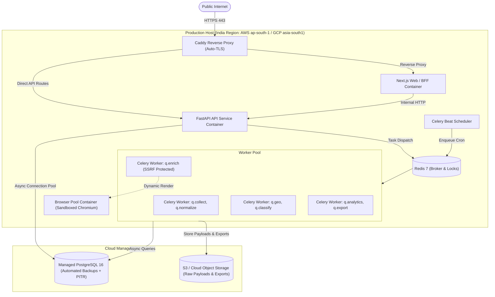
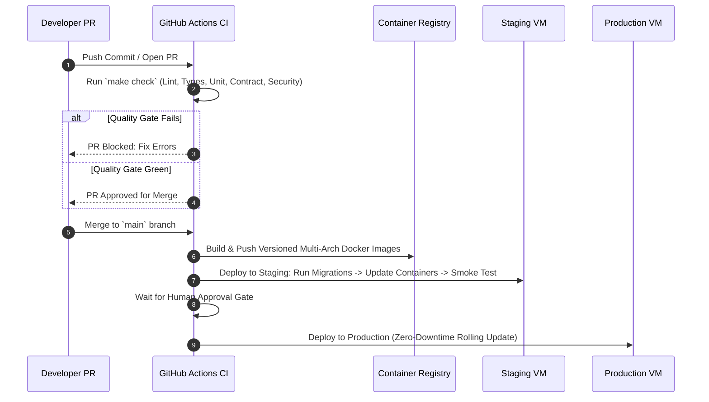

# Infrastructure & Deployment Specification — AdAtlas India

## 1. Purpose
Specify the cloud infrastructure topology, multi-stage container builds, network security controls, CI/CD deployment pipelines, database migration procedures, and disaster recovery plans for AdAtlas.

## 2. Scope
Applies to local development (`infra/docker-compose.yml`), staging environments, and production cloud infrastructure.

## 3. Decisions (Link ADRs)
- **ADR-0004:** India Region Cloud Hosting Topology.
- **ADR-0011:** Data Retention Schedules.
- **ADR-0012:** Modular Monolith Architecture.

## 4. Detailed Design

### 4.1 Production Infrastructure Topology

- **Cloud Hosting Provider & Region:** Deployed within India jurisdiction (AWS `ap-south-1` Mumbai or GCP `asia-south1` Mumbai) to comply with local data localization guidelines.
- **Compute Sizing (MVP Baseline):** Single cloud compute instance: 4 vCPU, 16 GB RAM, 100 GB NVMe block storage running Docker Engine.
- **Managed Persistence:** Managed PostgreSQL 16 instance with automated daily snapshots and 7-day Point-In-Time-Recovery (PITR).

### 4.2 Multi-Stage Docker Container Specifications
To minimize attack surface and image bloat, all containers employ multi-stage Docker builds based on slim Alpine or Debian images:
1. **`api` Container:** Runs Uvicorn with FastAPI; non-root user (`appuser`, uid 10001); no developer compilers in production image.
2. **`worker` Container:** Runs Celery worker processes; non-root user; mounts read-only configs.
3. **`browser-pool` Container:** Dedicated headless Chromium container running Playwright; sandboxed; IPC memory shared via `--shm-size=1gb`; non-root execution.
4. **`frontend` Container:** Next.js standalone output; Node.js 20-alpine runtime; non-root execution.

### 4.3 Network Isolation & Egress Firewall Rules
To enforce SSRF protection at the transport layer (SEC-01):
- Crawler workers (`q.enrich`) and headless browser containers execute within an isolated Docker bridge network (`adatlas-crawler-net`).
- Host-level `iptables` / cloud security group rules strictly drop any outbound connection originating from `adatlas-crawler-net` directed towards:
  - Loopback (`127.0.0.0/8`)
  - RFC 1918 private subnets (`10.0.0.0/8`, `172.16.0.0/12`, `192.168.0.0/16`)
  - Cloud metadata addresses (`169.254.169.254`)
  - PostgreSQL and Redis container ports.

### 4.4 CI/CD Pipeline (GitHub Actions)

### 4.5 Zero-Downtime Database Migration Discipline
- Schema migrations run as a distinct pre-deployment pipeline task via Alembic.
- **Expand-Migrate-Contract Rule:** Schema updates must never execute destructive modifications (dropping columns, changing types) in a single deployment. New columns are introduced as nullable; old columns are deprecated and removed in subsequent releases (PIPE-09).

### 4.6 Disaster Recovery & Quarterly Restore Drill
- **Backup Strategy:** Continuous PostgreSQL Write-Ahead Logging (WAL) shipped to cloud storage + daily full database dumps.
- **Retention:** Database backups retained for 90 days with AES-256 server-side encryption.
- **Mandatory Restore Drill:** A formal restore test must be executed successfully prior to production go-live and rehearsed on a scheduled quarterly cadence (`docs/RUNBOOKS/restore-from-backup.md`).

## 5. Edge-Case IDs Referenced
- `PIPE-02` (Worker process crash recovery)
- `PIPE-09` (Zero-downtime expand-contract migration)
- `SEC-01` (Egress firewall and SSRF isolation)
- `SEC-09` (Browser sandbox container isolation)
- `SEC-11` (Backup encryption and retention)
- `LEG-09` (Source purge command execution)

## 6. Open Questions
- Establishing cloud provider selection (AWS vs GCP) based on existing enterprise billing accounts during Phase 12.

## 7. Acceptance Checklist
- [x] Host compute sizing and cloud regional topology documented.
- [x] Multi-stage container definitions and non-root user rules specified.
- [x] Network namespace isolation and egress firewall rules defined.
- [x] GitHub Actions CI/CD pipeline flow mapped.
- [x] Database migration and quarterly disaster recovery drill committed.
- [x] All 6 referenced edge-case IDs cross-referenced.

## 8. Last Updated
- Date: 2026-11-04
- Version: 1.0 (Phase 0 Baseline)

