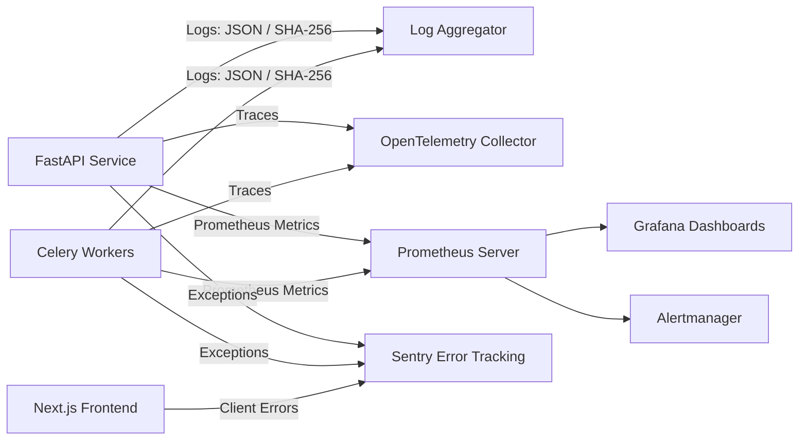

# Observability, Monitoring & Operations — AdAtlas India

## 1. Purpose
Define the telemetry architecture, structured logging formats, distributed tracing, Prometheus metric instruments, Service Level Objectives (SLOs), automated alerting rules, and operational runbook links.

## 2. Scope
Covers real-time operational monitoring and incident management across the FastAPI API service, Next.js web tier, Celery worker nodes, Redis broker, PostgreSQL database, and external scraper boundaries.

## 3. Decisions (Link ADRs)
- **ADR-0004:** India Region Cloud Hosting & Infrastructure Monitoring.
- **ADR-0006:** LLM Inference Budget & Quota Tracking.
- **ADR-0011:** Operational Audit Logging Retention.

## 4. Detailed Design

### 4.1 Telemetry Architecture Overview

### 4.2 Logging Standards (`structlog`)
- **JSON Formatting:** All logs emitted to stdout in production are machine-parseable JSON lines.
- **Contextual Correlation:** Every log entry binds `request_id` (propagated from HTTP header `X-Request-Id`), `user_id` (if authenticated), and `job_id` (for Celery background tasks).
- **Mandatory PII Scrubbing (SEC-10):**
  - Plaintext telephone numbers, email addresses, and personal names are scrubbed by a pre-serialization filter.
  - Contacts are represented strictly by contact type and truncated hash prefixes: `val_hash_prefix=sha256(val)[:8]`.

### 4.3 Key Prometheus Metrics Catalog

| Metric Identifier | Type | Labels | Operational Meaning & Usage |
|---|---|---|---|
| `ads_ingested_total` | Counter | `adapter`, `city` | Volume of raw ad items ingested per collection run. |
| `collect_runs_total` | Counter | `status`, `adapter` | Frequency of crawl executions (succeeded, failed, blocked). |
| `parse_failures_total` | Counter | `adapter`, `stage` | Parser validation failures indicating potential upstream schema drift. |
| `rows_vs_previous_run_ratio` | Gauge | `adapter`, `city` | Sanity ratio comparing current run yield to previous run. |
| `queue_depth` | Gauge | `queue` | Backlog depth across Celery task queues (`q.collect`, `q.enrich`, etc.). |
| `enrich_fetch_total` | Counter | `outcome`, `domain_class`| Outcomes of polite fetcher crawls (`success`, `robots_blocked`, `timeout`, `error`). |
| `ssrf_blocked_total` | Counter | `target_class` | Count of outbound requests aborted by `core.ssrf_guard`. |
| `contact_coverage` | Gauge | `city` | Percentage of confirmed city advertisers possessing verified contacts. |
| `geo_tier_count` | Gauge | `city`, `tier` | Total advertiser volume mapped to confirmed, probable, or weak tiers. |
| `budget_spent_ratio` | Gauge | `scope` | Fraction of daily/monthly spend cap exhausted (`spent / cap`). |
| `reveal_total` | Counter | `user_id` | Count of unmasked contact reveals executed per user. |
| `search_latency_seconds` | Histogram | `endpoint`, `city` | End-to-end API response latency distribution. |

### 4.4 Service Level Objectives (SLOs)
1. **API Availability:** $\ge 99.5\%$ successful responses (non-5xx) over a rolling 30-day window.
2. **Search Latency:** p95 latency $< 800\text{ ms}$ for standard city queries returning 50 items.
3. **Advertiser Refresh Freshness:** $\ge 95\%$ of Tier 1 (T1) active advertisers refreshed within $\le 36\text{ hours}$.
4. **Pipeline Processing Lag:** p95 duration from raw payload ingestion to normalized table write $< 30\text{ minutes}$.

### 4.5 Alerting Rules & Thresholds

| Alert Name | Trigger Condition | Severity | Notification Channel | Remediation Runbook |
|---|---|---|---|---|
| `CityIngestionStalled` | Zero new ads ingested for an active city in $> 24\text{ hours}$. | Critical | PagerDuty / Slack | `docs/RUNBOOKS/provider-failover.md` |
| `SchemaDriftDetected` | Parse failure rate $> 5\%$ of ingested batch. | High | Slack / Jira | `docs/RUNBOOKS/schema-drift-response.md` |
| `AnomalyRowCountDeviation` | Ingested row count deviates by $\pm 40\%$ vs previous run. | High | Slack | `docs/RUNBOOKS/provider-failover.md` |
| `BudgetThresholdExceeded` | Budget consumption reaches $\ge 80\%$ (warning) or $100\%$ (halt). | High / Critical | Email / PagerDuty | `docs/RUNBOOKS/kill-switch.md` |
| `DeadLetterQueueGrowth` | Dead letter queue contains un-replayed messages for $> 1\text{ hour}$. | Medium | Slack | Check `dead_letters` table |
| `SSRFProbeSpike` | `ssrf_blocked_total` increases by $> 10$ events in 5 minutes. | Critical | Security / PagerDuty | Investigate target domains |
| `ContactHarvestAnomaly` | Single user reveals $> 150$ contacts in 1 hour. | High | Security / Email | Audit user session; revoke token |
| `CollectorBlocked` | Scrape job encounters anti-bot challenge and transitions to `blocked`. | High | Slack | Wait out cool-down window |
| `BackupFailure` | Daily database backup fails or reports non-zero exit code. | Critical | PagerDuty | `docs/RUNBOOKS/restore-from-backup.md` |

### 4.6 Operational Runbook Registry
All standard response procedures are documented in `docs/RUNBOOKS/`:
- **`kill-switch.md`:** Triggering global and per-adapter collection halts.
- **`provider-failover.md`:** Switching commercial ingestion between primary and secondary providers.
- **`schema-drift-response.md`:** Updating parsing models upon upstream Meta layout changes.
- **`opt-out-takedown.md`:** Manual processing of complex data subject erasure requests.
- **`purge-by-source.md`:** Expunging records derived from a specific vendor or adapter.
- **`breach-response.md`:** Incident containment and statutory 72-hour DPDP breach reporting.
- **`restore-from-backup.md`:** Restoring PostgreSQL and MinIO state from point-in-time snapshots.
- **`rotating-secrets.md`:** Routine and emergency credential rotation.
- **`adding-a-city.md`:** Onboarding new metropolitan territories.

## 5. Edge-Case IDs Referenced
- `PIPE-03` (Dead-letter queue inspection and replay)
- `PIPE-08` (Budget runaway protection alerts)
- `PIPE-12` (Partial job metrics and health tracking)
- `SEC-06` (Log redaction verification)
- `SEC-10` (Zero PII in structured logs)
- `LEG-10` (Data breach operational runbook)

## 6. Open Questions
- Determining Sentry transaction sampling rates for high-throughput worker queues to stay within SaaS tier quotas.

## 7. Acceptance Checklist
- [x] Structured JSON logging standards and PII scrubbing rules committed.
- [x] Twelve critical Prometheus metric definitions documented with label schemas.
- [x] Four primary system SLO targets defined.
- [x] High-priority alerting matrix established.
- [x] Runbook registry index linked.

## 8. Last Updated
- Date: 2026-11-04
- Version: 1.0 (Phase 0 Baseline)

