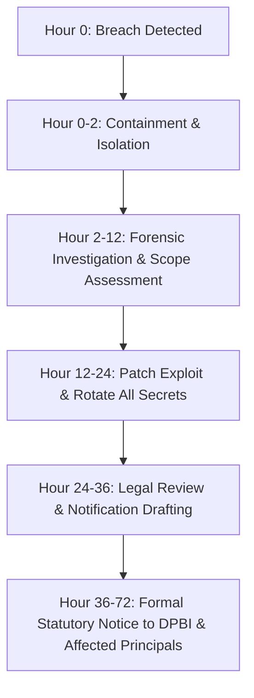

# Operational Runbook: Security Incident & Data Breach Response

## 1. Purpose
Define the immediate containment, forensic investigation, root-cause remediation, and statutory 72-hour notification procedures in the event of an unauthorized personal data exposure or security compromise under the Indian Digital Personal Data Protection Act (DPDP Act 2023 / DPDP Rules 2025).

## 2. Trigger Conditions
- Discovery of unauthorized access, credential theft, or exfiltration of database backups (SEC-11).
- Detection of an internal user bulk-harvesting unmasked contacts in violation of role policies (SRCH-05).
- Identification of an active SSRF, SQL injection, or remote code execution exploit (SEC-01, SEC-04).

## 3. Severity & Incident Team
- **Severity:** P0 (Critical Statutory Emergency)
- **Incident Response Team:** System Owner, Compliance Officer, Lead Security Engineer, Legal Counsel.

## 4. Execution Procedure (The 72-Hour Response Runway)



### Step 1: Immediate Containment (Hours 0–2)
1. Trigger Emergency Kill Switch (`docs/RUNBOOKS/kill-switch.md`).
2. Isolate compromised network containers or rotate firewall security groups to restrict all inbound traffic to internal bastion IPs.
3. Invalidate all active user sessions and Google OAuth JWT verification keys:
   ```bash
   docker compose exec redis redis-cli FLUSHDB
   ```
4. Revoke and rotate database credentials and cloud IAM access tokens (`docs/RUNBOOKS/rotating-secrets.md`).

### Step 2: Forensic Analysis & Scope Assessment (Hours 2–12)
1. Inspect PostgreSQL `audit_log` records to determine:
   - Exactly which user accounts or API keys initiated the unauthorized requests.
   - Total count of unmasked contact records exposed.
   - Originating IP addresses and timestamps.
2. Verify database cryptographic integrity: confirm whether encrypted fields or hashed suppression entries were compromised.
3. Preserve all container stdout logs, cloud network flow logs, and database transaction logs for forensic preservation.

### Step 3: Root-Cause Remediation (Hours 12–24)
1. Patch the underlying vulnerability (e.g. flawed SSRF transport rule, compromised dependency, or authorization check).
2. Run the master quality gate (`make check`) and security test suites to verify that the vulnerability is closed.
3. Re-deploy updated images to staging and production.

### Step 4: Statutory Breach Notification (Hours 24–72)
Under Section 8(6) of the DPDP Act 2023 and Rule 7 of the DPDP Rules 2025, the organization must notify the Data Protection Board of India (DPBI) and affected data principals promptly:
1. Legal counsel drafts the formal breach notification document, detailing:
   - Nature and extent of the personal data breach.
   - Likely consequences and risks to affected data principals.
   - Mitigation and containment measures adopted by the organization.
   - Point of contact for grievance redressal.
2. Submit notice to the DPBI designated portal within the statutory 72-hour timeline.
3. Dispatch individual notifications to affected users or corporate entities via registered email.

## 5. Post-Incident Review
Within 14 days of incident closure, conduct a blameless post-mortem, update `docs/RISK_REGISTER.md`, and record architectural adaptations in `docs/ADR/`.

