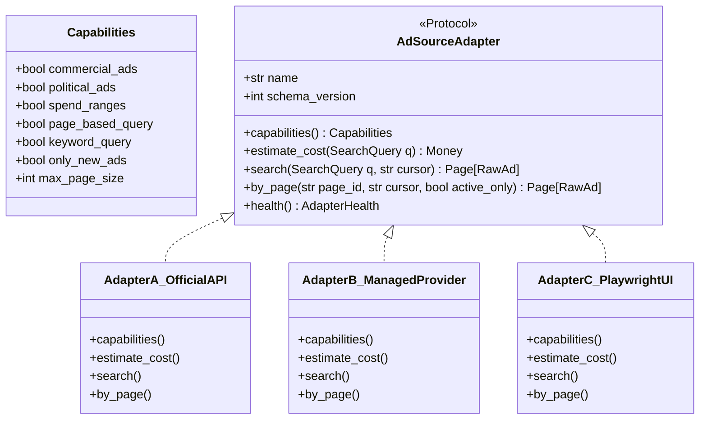

# Data Collection & Scraping Strategy — AdAtlas India

## 1. Purpose
Define the multi-adapter data ingestion strategy, search space expansion model, refresh cadences, budget safeguards, and the verified empirical reality of Meta's Ad Library ecosystem in India.

## 2. Scope
Governs all automated collection pipelines (`q.collect`), external adapter integrations (Adapter A, Adapter B, Adapter C), and upstream rate/budget accounting.

## 3. Decisions (Link ADRs)
- **ADR-0001:** Multi-Adapter Architecture (Adapter B primary, Adapter C disabled).
- **ADR-0002:** Ethical Boundaries & Prohibition of Facebook Profile Scraping.
- **ADR-0003:** Meta Developer App & Identity Confirmation Setup.

## 4. Detailed Design

### 4.1 Re-Verified Reality-Check Table
Empirically verified against live platform documentation and legal notices on 4 November 2026.

| ID | Verified Finding | Upstream Evidence / Source URL | Architectural & Operational Consequence | Engineering Response |
|---|---|---|---|---|
| **R1** | The official Meta Ad Library API strictly excludes commercial ads outside the EU/UK. Queries for Indian commercial campaigns return empty result sets. | Meta Developer Documentation (`developers.facebook.com/docs/graph-api/reference/ads_archive/`); Third-party benchmarks (`socialapis.io`, `metapi.io`). | An official-API-only architecture would fail completely for commercial advertiser intelligence in India. | **Multi-adapter architecture:** Adapter A (official API) ingests political/issue ads; Adapter B (licensed/managed provider) extracts commercial ads; Adapter C (own collector) built as emergency fallback but kept OFF. |
| **R2** | Spend, impressions, and exact audience demographic distributions are published ONLY for political/issue ads. Meta never discloses spend for commercial campaigns. | Meta Ad Library FAQ & Transparency Reports; EU Digital Services Act (DSA) declarations. | City ranking cannot be based on financial spend figures. Commercial ad spend models cannot be created without fabricating false data. | **Proxy-based city scoring:** Rank city vitality using measurable proxies (active advertiser density, net 30-day advertiser growth, creative longevity, direct-response CTA share, contact reachability). |
| **R3** | Meta Ad Library filters by country, platform, language, and keyword/page — NOT by geographical city or postal code. Keyword searches match body text, creating heavy false-positive noise (e.g. searching "Nike" returns local resellers). | Meta Ad Library UI (`facebook.com/ads/library`). | City search cannot be offloaded to Meta's search engine. | **Custom Geo-Attribution Engine:** Search queries capture candidates; a multi-signal Bayesian attribution engine independently verifies advertiser city association. |
| **R4** | The Meta Ad Library UI and API expose zero advertiser phone numbers, corporate emails, or postal addresses. | Meta Ad Library UI inspection. | Contacts cannot be extracted from Meta payloads. | **Independent Website Enrichment:** Follow destination landing page domains to extract publicly published business contacts via schema.org markup, tel/mailto anchors, and Google Places. |
| **R5** | Meta Terms of Service prohibit automated data collection without prior express written permission, regardless of login state. However, a January 2024 N.D. California court decision held that logged-out scraping of public web data does not breach general contract terms. | Meta Terms of Service (Automated Data Collection section); Legal review of *Meta v. BrandTotal* and related precedent. | Legal exposure exists for direct proprietary scrapers (Adapter C) and third-party data vendors. | **Provider abstraction + kill switch:** Tag every record by source adapter. Support instant purging per adapter. Require explicit counsel sign-off before enabling Adapter C. |
| **R6** | MeitY notified the final DPDP Rules on 13 Nov 2025. Staggered enforcement: Consent Manager registration begins 13 Nov 2026; full substantive Data Fiduciary obligations and financial penalties take effect on **13 May 2027**. | Gazette of India Notification; MeitY DPDP Rules 2025; Legal analyses (AZB & Partners, JSA). | The system operates in a pre-enforcement runway but must be designed to DPDP standards from day one. | Build to full DPDP standards immediately: data minimization (no PAN, GSTIN state only), provenance tracking, suppression registry, and 72-hour breach response runbooks. |
| **R7** | The internal JSON schemas and HTML structures of Meta's public Ad Library web interface undergo periodic, unannounced mutations. | Historic scraper changelogs and Apify actor release notes. | Direct scraping components will periodically fail or parse corrupted attributes. | **Contract tests & drift detection:** Run daily canary checks against recorded golden fixtures; auto-disable scraping workers upon detecting > 5% schema mutation; store immutable raw payloads. |
| **R8** | Inactive commercial ads vanish from the public Ad Library interface outside the EU shortly after campaigns conclude. | Empirical tests of Ad Library search results in India. | Historical ad duration cannot be derived from a single crawl snapshot. | **Observation logging:** Record first-seen, last-seen, and disappeared timestamps locally. Calculate ad longevity using survival analysis / right-censored observation windows. |
| **R9** | Commercial managed data providers price per successful result, historically spanning $0.40 to $5.00 per 1,000 ad records. | Apify, ScrapingBee, and Bright Data marketplace actor rate cards. | Unconstrained keyword scraping sweeps can result in severe budget exhaustion. | **Budget caps & targeted expansion:** Enforce strict per-job and monthly budget ceilings; prioritize page-based expansion over exhaustive keyword searches. |

### 4.2 Multi-Adapter Architecture

- **Adapter A (Official Meta Graph API `/ads_archive`):**
  - Used strictly for political, electoral, and social issue campaigns.
  - Captures authorized spend ranges, impression lower/upper bounds, and "Paid for by" disclaimer entities.
- **Adapter B (Managed Provider e.g. Apify Actor):**
  - Primary provider for commercial product and service advertisements.
  - Supports incremental delta filtering ("only new ads") and page-specific expansion.
  - Ingestion cost accounted against the central `budgets` ledger.
- **Adapter C (Proprietary Playwright Headless Scraper):**
  - Fully implemented with Chromium pooling and drift detection.
  - Kept **HARD OFF** (`ADAPTER_C_ENABLED=false`) until legal sign-off (D2) is formalized.

### 4.3 Ingestion Pipeline: Seed → Discover → Expand → Refresh
1. **Seed Generation:**
   - Cartesian product of designated cities × primary category taxonomy keywords × 6 language variants (English, Hinglish, Hindi, Bengali, Kannada, Marathi).
   - Generates deterministic seed query batches targeting active campaigns in India (`country=IN`).
2. **Page Discovery:**
   - Execute discovery sweeps. Extract unique `meta_page_id` values from search results.
   - Keyword hits represent potential advertiser leads, not conclusive city associations (R3).
3. **Advertiser Expansion:**
   - For newly discovered `meta_page_id` entries, query the adapter specifically by page (`by_page(page_id)`).
   - Retrieves the advertiser's complete inventory of concurrent active campaigns, landing domains, and creative variants.
4. **Tiered Refresh Strategy:**
   - **Tier 1 (T1 - High Priority):** Confirmed-city advertisers with active ads and either high ad velocity (> 10 ads) or missing contacts. Refreshed every **24 hours**.
   - **Tier 2 (T2 - Standard):** Other confirmed/probable advertisers with active ads. Refreshed every **7 days**.
   - **Tier 3 (T3 - Dormant):** Advertisers with zero active ads over the past 30 days. Checked every **30 days** for re-activation.
   - **Discovery Sweeps:** Broad category keyword sweeps run daily for top 50 categories; comprehensive sweeps run weekly.
5. **Delta Detection & Disappearance Tracking:**
   - Incoming ad payloads compute `content_hash = sha256(norm_body + headline + cta + landing_domain)`.
   - Existing ads matching `meta_ad_id` update `last_seen_at`.
   - If an ad is absent during two consecutive page refreshes, its status transitions to `disappeared` with `disappeared_at = now()`.

### 4.4 Operational Safeguards & Cost Controls
- **Dry-Run Mode Mandatory for Sweeps:** Every collection task must support `--dry-run`, calculating projected ad volume, API unit costs, and total projected spend before enqueueing worker tasks.
- **Hard Spend Caps:** If `budgets.spent` reaches 80% of `cap`, trigger high-priority alerts; if spend hits 100%, subsequent external adapter requests fail closed.
- **Emergency Kill Switch:** Global toggle halts all workers within 60 seconds.

## 5. Edge-Case IDs Referenced
- `SRC-01` (Official API restrictions on Indian commercial ads)
- `SRC-02` (API access token expiration)
- `SRC-03` (Adaptive backoff on rate limit headers)
- `SRC-07` (Managed provider schema drift)
- `SRC-10` (No anti-bot or CAPTCHA bypass)
- `SRC-14` (Commercial ad disappearance tracking)
- `PIPE-08` (Budget runaway protection)

## 6. Open Questions
- Target evaluation of secondary backup managed providers to eliminate single-vendor dependency for Adapter B.

## 7. Acceptance Checklist
- [x] All 9 reality-check findings re-verified with live sources and documented.
- [x] Multi-adapter interface specifications and role definitions committed.
- [x] Ingestion lifecycle (Seed, Discover, Expand, Refresh) fully articulated.
- [x] Refresh cadences and delta detection mechanisms specified.
- [x] Budget enforcement and dry-run requirements documented.

## 8. Last Updated
- Date: 2026-11-04
- Version: 1.0 (Phase 0 Baseline)

