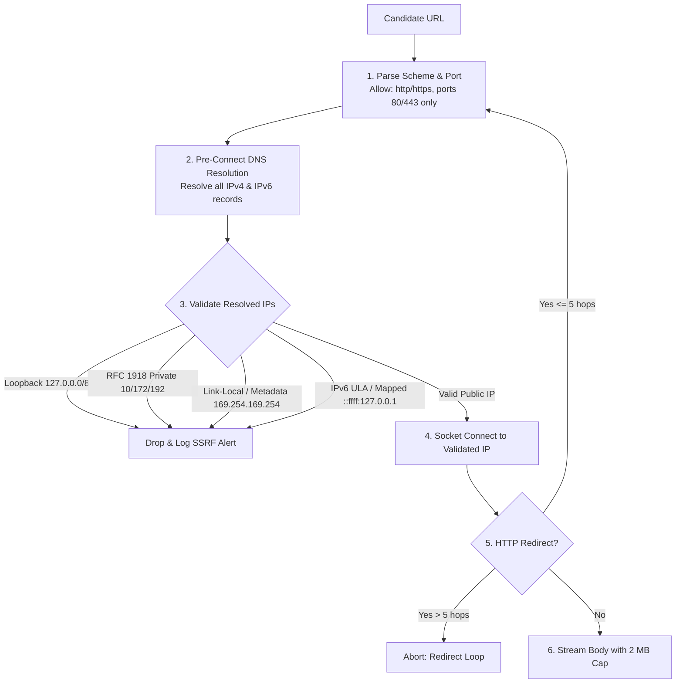

# Application Security & Threat Model Specification — AdAtlas India

## 1. Purpose
Define the security architecture, threat model (STRIDE), SSRF-safe network transport design, access control policies, and secret management standards for the AdAtlas platform.

## 2. Scope
Covers all system attack surfaces: external web crawlers, API endpoints, authentication flows, data storage, CI/CD pipelines, and asynchronous Celery workers.

## 3. Decisions (Link ADRs)
- **ADR-0004:** India Region Cloud Hosting Topology.
- **ADR-0005:** Auth.js Google OAuth with Signed BFF JWT Tokens.
- **ADR-0012:** Modular Monolith Internal Network Segmentation.

## 4. Detailed Design

### 4.1 STRIDE Threat Analysis Matrix

| Threat Category | Potential Attack Vector | System Defense & Mitigation Strategy | Test / Audit ID |
|---|---|---|---|
| **Spoofing** | Forged user requests or unauthorized API calls. | Google OAuth via Auth.js; BFF issues short-lived (5 min) HMAC-SHA256 signed JWTs with explicit user ID and role claims; verified by FastAPI middleware. | `test_security_jwt_signature_verification` |
| **Tampering** | SQL injection in search filters; ad copy XSS injection; CSV formula injection. | Parameterized queries via SQLAlchemy; strict Pydantic schemas; React JSX auto-escaping; CSV formula prefixing for `= + - @ tab CR` cells. | `test_security_sql_injection_defense` `test_security_csv_formula_injection_guard` |
| **Repudiation** | User denies revealing sensitive contacts or downloading large prospect lists. | Append-only `audit_log` records every contact reveal and export generation with user UUID, IP address, timestamp, and target entity IDs. | `test_security_audit_log_completeness` |
| **Information Disclosure** | SSRF accessing cloud metadata; PII leaked in logs; IDOR on exports. | Pre-connect DNS IP validation in `core.ssrf_guard`; contact values masked by default; logs record SHA-256 prefixes; UUIDs + user ownership checks. | `test_security_ssrf_egress_blocking` `test_security_log_pii_redaction_filter` |
| **Denial of Service** | Resource exhaustion via scraper loops, compression bombs, or quota flooding. | Per-domain token-bucket rate limits; 2 MB body caps; depth-1 limits; Celery queue backpressure; budget caps on external APIs. | `test_enrich_crawler_trap_containment` `test_security_optout_rate_limiting` |
| **Elevation of Privilege** | Viewers attempting contact unmasking or admin tasks. | Strict FastAPI role dependencies (`viewer`, `marketing`, `compliance`, `admin`); 403 Forbidden enforced at router level. | `test_security_rbac_privilege_enforcement` |

### 4.2 SSRF-Safe Outbound Crawling Architecture (SEC-01)
Outbound web crawling presents severe Server-Side Request Forgery risks (e.g. pivoting into internal AWS/GCP metadata endpoints `169.254.169.254`, container runtime sockets, or local database ports).

#### Technical Implementation Rules:
1. **Custom HTTP Transport:** All crawling is executed via `core.ssrf_guard.PoliteFetcher`, utilizing a custom `httpx.AsyncHTTPTransport` that overrides DNS resolution and socket binding.
2. **Re-Validation on Redirects:** Every redirect response is intercepted; target location headers must repeat the complete validation cycle before connection.
3. **Egress Firewall Rules:** Crawler containers in production run inside an isolated Docker bridge network where iptables rules block outbound connections to RFC 1918 ranges and link-local subnets regardless of application logic.

### 4.3 Headless Browser Pool Sandboxing (SEC-09)
When dynamic JavaScript rendering is required for contact extraction:
- Playwright instances run in a dedicated container (`browser-pool`) separate from API and worker services.
- Containers run as an unprivileged non-root user (`uid=10001`) with a read-only root filesystem and ephemeral tmpfs for browser caching.
- File downloads, clipboard access, WebRTC, and media streaming are permanently disabled via Chromium launch arguments.
- Browser processes are completely recycled every 50 page fetches to prevent memory leaks and state retention (PIPE-10).

### 4.4 Data Protection & Secret Hygiene
- **Zero Contact Values in Application Logs (SEC-10):**
  - Plaintext telephone numbers and email addresses are filtered by a custom `structlog` processor.
  - Diagnostic logs record only cryptographic hash prefixes: `value_hash[:8]`.
- **Automated Secret Leak Detection (SEC-06):**
  - `gitleaks` runs as a mandatory pre-commit hook and CI gate.
  - Secret keys and API tokens are loaded strictly via environment variables conforming to Pydantic Settings models.
- **Formula Injection Defense (SEC-03):**
  - All data exported to CSV or XLSX formats is sanitized. If any cell starts with `=`, `+`, `-`, `@`, `\t`, or `\r`, it is prepended with a single quote (`'`) to disable formula execution in Excel/Sheets.
- **Supply-Chain Security (SEC-08):**
  - Dependencies are cryptographically locked in `uv.lock` and `pnpm-lock.yaml`.
  - Packages published within the trailing 14 days are barred from production deployments.
  - Daily vulnerability audits run via `pip-audit` and `npm audit`.

## 5. Edge-Case IDs Referenced
- `SEC-01` (SSRF IP validation and redirect interception)
- `SEC-02` (XSS mitigation via JSX escaping)
- `SEC-03` (CSV/Excel formula injection defense)
- `SEC-04` (Parameterized SQL queries)
- `SEC-05` (Prompt injection isolation)
- `SEC-06` (Secret leak detection)
- `SEC-07` (IDOR authorization check)
- `SEC-08` (Supply-chain cool-off rule)
- `SEC-09` (Browser sandbox isolation)
- `SEC-10` (Zero PII in logging)
- `SEC-11` (Backup encryption)
- `SEC-12` (Rate limiting on auth and opt-out)

## 6. Open Questions
- None blocking Phase 0. Ongoing verification of custom httpx transport implementation in Phase 6.

## 7. Acceptance Checklist
- [x] Comprehensive STRIDE threat model documented.
- [x] SSRF-safe network flow diagram and socket binding constraints defined.
- [x] Headless browser sandboxing parameters specified.
- [x] PII log scrubbing and formula injection protections detailed.
- [x] All 12 SEC edge-case IDs cross-referenced.

## 8. Last Updated
- Date: 2026-11-04
- Version: 1.0 (Phase 0 Baseline)

