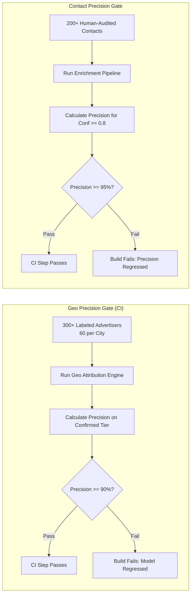

# Comprehensive Testing Strategy & Quality Assurance — AdAtlas India

## 1. Purpose
Define the multi-tier testing methodology, hermetic verification principles, coverage thresholds, performance benchmarks, and automated quality gates governing the AdAtlas engineering lifecycle.

## 2. Scope
Covers all unit, property, contract, integration, end-to-end, security, data quality, load, and chaos test suites across backend, frontend, and worker infrastructure.

## 3. Decisions (Link ADRs)
- **ADR-0001:** Contract Testing for Pluggable Ingestion Adapters.
- **ADR-0008:** Mocked Google Places Testing via Recorded Fixtures.
- **ADR-0014:** Benchmark Validation of Geo-Attribution Precision.

## 4. Detailed Design

### 4.1 The Hermetic Testing Principle
To ensure deterministic, repeatable, and cost-controlled CI/CD runs:
- **Zero External Network Dependencies:** Automated CI pipelines and local developer test runs MUST NOT make live network requests to Meta APIs, commercial scrapers, Google Places API, LLM providers, or target third-party business websites.
- **Fixture Replay:** All HTTP interactions are mocked or served from version-controlled, sanitized cassettes (`vcrpy` or `respx`).
- **Containerized Ephemeral Infrastructure:** Integration tests utilize `testcontainers` to launch lightweight, transient instances of PostgreSQL 16, Redis 7, and MinIO.

### 4.2 Test Pyramid & Execution Matrix

| Test Layer | Primary Focus | Tooling & Frameworks | Quality Threshold / Gate |
|---|---|---|---|
| **Unit & Property** | Text normalization, phone/email parsers, Indic transliteration, Noisy-OR Bayesian math, suppression logic, formula injection escaping. | `pytest`, `hypothesis` | Critical modules $\ge 95\%$ line coverage; general pipeline $\ge 80\%$. |
| **Adapter Contract** | Verifying all collector adapters (Adapter A, B, C) emit identical Pydantic structures; detecting schema mutations in mock payloads. | `vcrpy`, `respx` | 100% pass across unified contract test suite. |
| **Integration** | Multi-stage Celery worker execution (`collect` $\to$ `normalize` $\to$ `geo` $\to$ `enrich` $\to$ `classify` $\to$ `analytics`); idempotency; `reprocess --from-raw`. | `pytest`, `testcontainers` | Full idempotency: running batch twice results in zero duplicate rows and zero unexpected updates. |
| **Security Suite** | Dedicated SSRF test server asserting drops on private/link-local/metadata IPs; XSS payloads in ad text; CSV formula injection; IDOR on exports. | Custom test harness, `schemathesis` | Zero security violations or unhandled injections. |
| **End-to-End (E2E)** | User journeys: search city $\to$ filter $\to$ reveal contact $\to$ export list $\to$ submit public opt-out $\to$ assert suppression in search/export. | `Playwright Test` | Green execution across Chromium, Firefox, WebKit. |
| **Data Quality & Benchmarks** | Geo-attribution precision benchmark on $\ge 300$ labeled advertisers; contact extraction precision sample ($\ge 200$ human-verified contacts). | `pandera`, custom scripts | Confirmed-tier geo precision $\ge 90\%$; contact precision $\ge 95\%$ for confidence $\ge 0.8$. |
| **Performance & Load** | API response latency under simulated load of 1,000,000 synthetic ads and 100 concurrent virtual users. | `k6` | Search API p95 $< 800\text{ ms}$; City Compare p95 $< 1.5\text{ s}$. |
| **Chaos & Resilience** | Worker process kill mid-task; simulated provider 500 errors; Redis restart; database failover recovery. | Custom bash scripts | Zero data loss; uncompleted jobs safely resumed from cursor checkpoints. |
| **Accessibility (A11y)** | WCAG 2.2 AA accessibility scan across all public and authenticated views. | `@axe-core/playwright` | Zero critical or serious accessibility violations. |

### 4.3 Data Quality Benchmark Protocols



### 4.4 Master Quality Gate: `make check`
Before any code change is merged to `main` or a phase transition is approved, the developer or agent must execute the master quality gate:
```bash
make check
```
This target enforces:
1. Python formatting & linting (`ruff format --check`, `ruff check`).
2. Python static type checking (`mypy --strict`).
3. Frontend linting and type checking (`pnpm lint`, `pnpm typecheck`).
4. Hermetic unit, property, contract, and integration tests (`pytest`).
5. Security linters and secret scanning (`gitleaks`, `pip-audit`, `pnpm audit`).
6. Accessibility scans on compiled frontend pages.

## 5. Edge-Case IDs Referenced
- `SRC-01` to `SRC-19` (Validated via adapter contract and integration suites)
- `GEO-01` to `GEO-13` (Validated via unit tests and 300+ geo evaluation set)
- `CON-01` to `CON-20` (Validated via property tests and contact precision sample)
- `SEC-01` to `SEC-12` (Validated via dedicated security test suite)
- `PIPE-01` to `PIPE-13` (Validated via idempotency and chaos resilience tests)

## 6. Open Questions
- Calibrating k6 load test execution duration in CI to balance thoroughness with runner execution limits.

## 7. Acceptance Checklist
- [x] Hermetic testing principle and fixture replay requirements established.
- [x] Nine testing layers documented with assigned tools and quality gates.
- [x] Geo attribution and contact precision benchmark protocols specified.
- [x] Unified `make check` command requirements committed.
- [x] Relevant edge cases cross-referenced.

## 8. Last Updated
- Date: 2026-11-04
- Version: 1.0 (Phase 0 Baseline)

